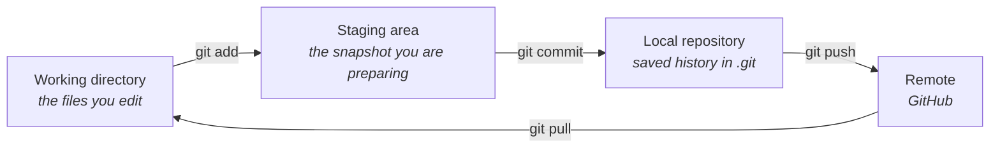
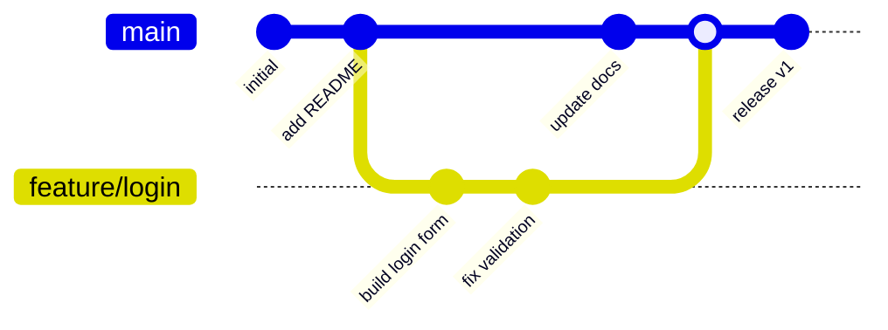
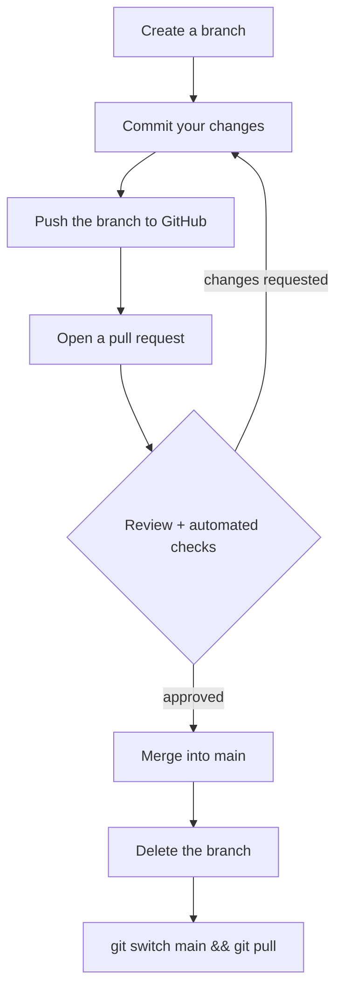

# Git & GitHub for Beginners

A practical introduction to version control: what it is, why it exists, and the handful of commands you actually use every day.

No prior experience assumed. Every command below is safe to run in a throwaway folder while you learn.

---

## Table of contents

1. [The problem Git solves](#1-the-problem-git-solves)
2. [Git vs GitHub](#2-git-vs-github)
3. [Set up your machine](#3-set-up-your-machine)
4. [The mental model: three places your code lives](#4-the-mental-model-three-places-your-code-lives)
5. [Your first repository](#5-your-first-repository)
6. [The daily loop](#6-the-daily-loop)
7. [Branches](#7-branches)
8. [Connecting to GitHub](#8-connecting-to-github)
9. [Pull requests: how teams actually work](#9-pull-requests-how-teams-actually-work)
10. [Merge conflicts](#10-merge-conflicts)
11. [Undo cheat sheet](#11-undo-cheat-sheet)
12. [What not to commit (.gitignore)](#12-what-not-to-commit-gitignore)
13. [Habits that make you look competent](#13-habits-that-make-you-look-competent)
14. [Common beginner mistakes](#14-common-beginner-mistakes)
15. [One-page cheat sheet](#15-one-page-cheat-sheet)
16. [Where to go next](#16-where-to-go-next)

---

## 1. The problem Git solves

You have probably named a file `report-final-v2-FINAL-actual.docx`. Git replaces that entirely.

Git is a **version control system**: it records snapshots of your project over time, so you can:

- See exactly what changed, when, and by whom.
- Go back to any earlier state.
- Work on a new idea without breaking the working version.
- Combine work from several people without emailing zip files.

A Git repository is just a folder with a hidden `.git` subfolder inside it that stores the entire history.

> [!note]
> Git is **local**. Everything — commits, branches, history — works with no internet and no account anywhere.

---

## 2. Git vs GitHub

These are two different things, and beginners mix them up constantly.

| | Git | GitHub |
|---|---|---|
| What it is | A program that tracks versions | A website that hosts Git repositories |
| Runs where | On your computer | In the cloud |
| Made by | Linus Torvalds, 2005 | Microsoft (since 2018) |
| Needs the internet? | No | Yes |
| Alternatives | — | GitLab, Bitbucket, Codeberg |

**Analogy:** Git is the camera that takes photos of your project. GitHub is the photo album you share with other people.

You can use Git for years without ever touching GitHub.

---

## 3. Set up your machine

### Install Git

```bash
# macOS (comes with Xcode command line tools)
git --version

# if missing
xcode-select --install

# Debian/Ubuntu
sudo apt install git

# Windows: download from https://git-scm.com/download/win
```

### Tell Git who you are

Git stamps every commit with a name and email. Do this once:

```bash
git config --global user.name "Your Name"
git config --global user.email "you@example.com"

# Set the default branch name to `main` (matches GitHub)
git config --global init.defaultBranch main

# Nicer, colourised output
git config --global color.ui auto

# Check what you set
git config --list
```

> [!warning]
> Use the **same email** you will use on GitHub. If they differ, GitHub won't link your commits to your profile.

---

## 4. The mental model: three places your code lives

Nearly every Git confusion disappears once you understand this picture.



1. **Working directory** — your normal files. Git watches but does not save anything automatically.
2. **Staging area** (a.k.a. index) — a waiting room. You choose which changes go into the next commit.
3. **Repository** — the permanent history. Each `git commit` writes one snapshot here.

The staging area exists so you can commit *some* of your changes while leaving others half-finished.

A **commit** is a snapshot plus a message plus a pointer to the previous commit. History is a chain of these snapshots.

---

## 5. Your first repository

```bash
mkdir my-project
cd my-project

git init                 # turn this folder into a repo
git status               # nothing committed yet

echo "# My Project" > README.md

git status               # README.md is "untracked"
git add README.md        # move it to the staging area
git status               # now "Changes to be committed"
git commit -m "Add initial README"

git log --oneline        # see your first commit
```

That is the entire core loop: **edit → add → commit**.

### What a commit needs

- A change to record.
- A message. Short imperative subject line, under ~50 characters: `Add login form`, not `added login form stuff`.
- Optionally a body explaining *why*, separated by a blank line:

```bash
git commit -m "Fix crash when email is empty" -m "The validator returned null instead of false, so the null check was skipped."
```

---

## 6. The daily loop

These five commands cover 90% of real usage.

```bash
git status                  # what's changed, what's staged
git diff                    # unstaged line-by-line changes
git diff --staged           # what's about to be committed
git add <file>              # stage one file
git add .                   # stage everything in this folder
git commit -m "message"     # save a snapshot
git log --oneline --graph   # history, compact
```

### Reading `git status`

| Message | Meaning |
|---|---|
| `Untracked files` | Git has never seen this file. `git add` it. |
| `Changes not staged for commit` | Tracked file was edited. `git add` to include it. |
| `Changes to be committed` | Staged. A commit will include it. |
| `nothing to commit, working tree clean` | Everything is saved. |

### Viewing what changed

```bash
git diff                      # working dir vs staging
git diff --staged             # staging vs last commit
git log -p README.md          # full history of one file with diffs
git show HEAD                 # the most recent commit in detail
```

---

## 7. Branches

A branch is a movable label pointing at a commit. Creating one is instant and costs nothing, which is why Git users branch constantly.

The default branch is `main` (older repos use `master`). Everything you ship eventually lands there.



### Everyday commands

```bash
git branch                       # list branches (* marks current)
git switch -c feature/login      # create AND switch to a new branch
git switch main                  # switch to an existing branch
git merge feature/login          # merge that branch INTO the current one
git branch -d feature/login      # delete it once merged
```

> [!tip]
> `git switch` and `git restore` are the modern commands. You will see `git checkout` everywhere in older tutorials — it still works, it just does too many jobs. Learn `switch` first.

### The standard workflow

```bash
git switch main
git pull                          # get the latest
git switch -c fix/typo-in-readme  # branch off
# ...edit files...
git add .
git commit -m "Fix typo in README"
git switch main
git merge fix/typo-in-readme
```

**Rule of thumb:** one branch per task. Branch names like `feature/search`, `fix/login-crash`, `docs/install-guide` are self-documenting.

---

## 8. Connecting to GitHub

### Create the remote repository

1. Go to [github.com](https://github.com) → **New repository**.
2. Give it a name. Do **not** initialise with a README if you already have local commits.
3. Copy the URL GitHub shows.

### Link your local repo and push

```bash
git remote add origin https://github.com/yourname/my-project.git
git remote -v                       # verify
git branch -M main                  # make sure the branch is called main
git push -u origin main             # first push; -u remembers the link
```

After the first push, plain `git push` and `git pull` are enough.

### Authentication

GitHub no longer accepts your account password over HTTPS. Pick one:

| Method | How |
|---|---|
| **SSH** (recommended) | `ssh-keygen -t ed25519 -C "you@example.com"`, then add `~/.ssh/id_ed25519.pub` at GitHub → Settings → SSH keys |
| **HTTPS + token** | Create a Personal Access Token at GitHub → Settings → Developer settings, use it as the password |
| **GitHub CLI** | `gh auth login` handles everything for you |

Test SSH with:

```bash
ssh -T git@github.com     # should say "Hi username! You've successfully authenticated"
```

### Cloning someone else's project

```bash
git clone https://github.com/user/repo.git
cd repo
```

`clone` downloads the full history, not just the latest files, and sets up `origin` for you.

### Keeping in sync

```bash
git fetch            # download new commits, change nothing locally
git pull             # fetch + merge into your current branch
git push             # upload your commits
```

> [!warning]
> `git pull` while you have uncommitted changes can get messy. Commit or stash first.

---

## 9. Pull requests: how teams actually work

On a team you rarely push straight to `main`. You push a branch and ask for review via a **pull request** (PR).



Step by step:

```bash
git switch -c feature/search
# ...work...
git add .
git commit -m "Add search box to header"
git push -u origin feature/search
```

Then on GitHub: **Compare & pull request** → write a description of *what* and *why* → **Create pull request**.

A good PR description is short but says:

- What problem it solves.
- What you changed, and anything a reviewer should look at carefully.
- How you tested it.

### Contributing to a project you don't own

You cannot push to someone else's repo. Instead:

1. **Fork** it (button on GitHub) — creates your own copy.
2. Clone *your* fork.
3. Create a branch, commit, push to your fork.
4. Open a pull request from your fork to the original repo.

### Keeping a fork up to date

```bash
git remote add upstream https://github.com/original/repo.git
git fetch upstream
git switch main
git merge upstream/main
git push
```

---

## 10. Merge conflicts

A conflict happens when two branches change **the same lines** of the same file. Git stops and asks you to decide.

```text
<<<<<<< HEAD
const timeout = 30;
=======
const timeout = 60;
>>>>>>> feature/config
```

- Between `<<<<<<<` and `=======` → the version on your current branch.
- Between `=======` and `>>>>>>>` → the incoming version.

Fix it by editing the file into the version you actually want, then **delete all three marker lines**:

```bash
git add the-file.js
git commit            # completes the merge
```

Useful during a conflict:

```bash
git status            # lists conflicted files
git merge --abort     # panic button: undo the whole merge
```

> [!tip]
> Small, frequent commits and short-lived branches make conflicts rare and tiny. Conflicts are not errors — they are Git asking a question you are the only one who can answer.

---

## 11. Undo cheat sheet

Git's undo commands are not all the same kind of undo. Match the command to **where** the mistake is.

| Situation | Command | Safe? |
|---|---|---|
| Discard edits in one file | `git restore file.txt` | Destroys uncommitted changes |
| Unstage a file (keep edits) | `git restore --staged file.txt` | Safe |
| Fix the last commit message | `git commit --amend -m "new message"` | Safe if not pushed |
| Add a forgotten file to last commit | `git add forgotten.txt && git commit --amend --no-edit` | Safe if not pushed |
| Undo last commit, keep changes staged | `git reset --soft HEAD~1` | Safe |
| Undo last commit, keep changes unstaged | `git reset HEAD~1` | Safe |
| Undo last commit and delete the changes | `git reset --hard HEAD~1` | **Destructive** |
| Undo a commit that is already pushed | `git revert <hash>` | Safe — makes a new commit |
| Temporarily shelve work | `git stash` / `git stash pop` | Safe |
| Recover a lost commit | `git reflog` then `git reset --hard <hash>` | Usually saves you |

> [!warning]
> Never `reset --hard` or force-push a branch other people are using. Use `revert` on shared branches; it adds a commit that undoes the old one instead of rewriting history.

---

## 12. What not to commit (.gitignore)

Some files should never enter history: secrets, build output, dependencies, OS clutter.

Create a `.gitignore` at the repo root:

```gitignore
# dependencies
node_modules/
venv/
.venv/

# build output
dist/
build/
*.pyc
__pycache__/

# secrets — never commit these
.env
.env.local
*.pem

# editor / OS
.vscode/
.idea/
.DS_Store

# logs
*.log
```

Rules:

- One pattern per line; `#` starts a comment.
- `folder/` ignores a whole directory; `*.log` matches by extension.
- `.gitignore` does **not** affect files already tracked. Remove them first:

```bash
git rm --cached .env        # stop tracking, keep the file on disk
git commit -m "Stop tracking .env"
```

If you ever commit a password or API key, assume it is compromised. Rotate the key — deleting the file later does not remove it from history.

---

## 13. Habits that make you look competent

**Commit messages**

```text
Add retry logic to upload job       ✅ imperative, specific
fix stuff                           ❌
Updated the file I was working on   ❌
```

Common prefix convention (Conventional Commits), optional but widely understood:

| Prefix | Use for |
|---|---|
| `feat:` | new feature |
| `fix:` | bug fix |
| `docs:` | documentation only |
| `refactor:` | code change, no behaviour change |
| `test:` | tests |
| `chore:` | tooling, dependencies |

**Commit size** — one logical change per commit. "Fix bug and reformat entire file" is two commits.

**Before you push** — run `git status` and `git diff --staged` once. Every accidental commit of a secret or debug print starts here.

**Pull before you start** — reduces conflicts to nearly zero.

---

## 14. Common beginner mistakes

| Mistake | What to do instead |
|---|---|
| Committing `node_modules/`, `.env`, or huge binaries | Add them to `.gitignore` *before* the first commit |
| One giant "initial commit" of everything | Commit in logical chunks as you build |
| Working directly on `main` forever | Branch per task, even solo |
| `git push --force` on a shared branch | `git revert` or `--force-with-lease`, and tell your team |
| Panicking at `detached HEAD` | `git switch main` gets you out safely |
| Editing files on GitHub and forgetting to pull | Always `git pull` before starting work |
| Deleting a repo folder to "start over" | `git status` + `git log` first; history is usually recoverable |
| Copy-pasting commands without reading them | `--hard`, `--force`, `clean -fd` all delete things |

---

## 15. One-page cheat sheet

### Setup (once)

```bash
git config --global user.name "Your Name"
git config --global user.email "you@example.com"
git config --global init.defaultBranch main
```

### Start

```bash
git init                     # new local repo
git clone <url>              # copy an existing repo
git remote add origin <url>  # link to GitHub
```

### Daily

```bash
git status
git diff
git add <file> | git add .
git commit -m "message"
git pull
git push
```

### Branches

```bash
git branch
git switch -c feature/x
git switch main
git merge feature/x
git branch -d feature/x
```

### Inspect

```bash
git log --oneline --graph --all
git show <hash>
git diff main..feature/x
git blame file.txt
```

### Rescue

```bash
git restore <file>
git restore --staged <file>
git commit --amend
git revert <hash>
git stash / git stash pop
git reflog
```

---

## 16. Where to go next

- **Practise interactively:** [learngitbranching.js.org](https://learngitbranching.js.org) — the best free branching trainer.
- **Official book:** [git-scm.com/book](https://git-scm.com/book) — free, and chapters 1–3 cover everything here in more depth.
- **GitHub's own guides:** [docs.github.com/get-started](https://docs.github.com/get-started)
- **Reference:** `git help <command>` offline, or [git-scm.com/docs](https://git-scm.com/docs)

### If you remember only three things

1. **Edit → `git add` → `git commit`.** That is Git.
2. **A branch is free.** Make one per task.
3. **`git status` is always the right first command** when you are unsure.
