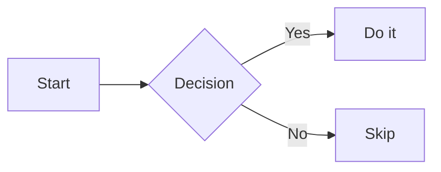

# Markdown Learning Guide for Beginners

> Markdown is a lightweight markup language that lets you format plain text using simple symbols. This guide walks you from zero to confident.

---

## Table of Contents

1. [What is Markdown?](#what-is-markdown)
2. [Why Use Markdown?](#why-use-markdown)
3. [Your First Markdown Document](#your-first-markdown-document)
4. [Headings](#headings)
5. [Paragraphs and Line Breaks](#paragraphs-and-line-breaks)
6. [Emphasis: Bold, Italic, Strikethrough](#emphasis-bold-italic-strikethrough)
7. [Lists](#lists)
8. [Links](#links)
9. [Images](#images)
10. [Code](#code)
11. [Blockquotes](#blockquotes)
12. [Horizontal Rules](#horizontal-rules)
13. [Tables](#tables)
14. [Task Lists](#task-lists)
15. [Escaping Characters](#escaping-characters)
16. [Extended Syntax (GitHub Flavored Markdown)](#extended-syntax-github-flavored-markdown)
17. [Best Practices](#best-practices)
18. [Quick Reference Cheat Sheet](#quick-reference-cheat-sheet)

---

## What is Markdown?

Markdown is a **plain-text formatting syntax** created by John Gruber in 2004. You write text with a few simple symbols, and a Markdown renderer turns it into nicely formatted HTML.

**Key idea:** The source file stays readable even before rendering.

```
# Hello World
This is **bold** and this is *italic*.
```

Renders as:

> # Hello World
> This is **bold** and this is *italic*.

---

## Why Use Markdown?

- **Simple** — learn in minutes
- **Portable** — plain text works everywhere
- **Version-control friendly** — great for Git diffs
- **Universal** — used by GitHub, Reddit, Slack, Discord, Notion, Obsidian, and more
- **Readable** — looks fine even without rendering

---

## Your First Markdown Document

Create a file named `hello.md` and write:

```markdown
# My First Note

Hello, world! I am learning **Markdown**.

- Item one
- Item two
- Item three

Visit [OpenAI](https://openai.com).
```

Save it, then open it in any Markdown viewer (VS Code, Obsidian, GitHub, etc.).

---

## Headings

Use `#` symbols. One `#` is the largest (H1), six `#` is the smallest (H6).

```markdown
# Heading 1
## Heading 2
### Heading 3
#### Heading 4
##### Heading 5
###### Heading 6
```

**Rules:**
- Always put a space after `#`.
- Use only **one** H1 per document (the title).
- Don't skip levels (go H1 → H2 → H3, not H1 → H3).

---

## Paragraphs and Line Breaks

Paragraphs are separated by a **blank line**.

```markdown
This is paragraph one.

This is paragraph two.
```

For a **hard line break** (new line without a new paragraph), end a line with **two spaces** or use a backslash:

```markdown
Line one  
Line two

Line one\
Line two
```

> Tip: Avoid relying on trailing spaces — they're invisible. Use `\` instead.

---

## Emphasis: Bold, Italic, Strikethrough

| Style | Syntax | Result |
|-------|--------|--------|
| Italic | `*text*` or `_text_` | *text* |
| Bold | `**text**` or `__text__` | **text** |
| Bold + Italic | `***text***` | ***text*** |
| Strikethrough | `~~text~~` | ~~text~~ |

**Best practice:** Prefer `*` for emphasis and `**` for strong. Avoid mixing `*` and `_` in the same word.

---

## Lists

### Unordered Lists

Use `-`, `*`, or `+` (be consistent — pick one).

```markdown
- Apples
- Bananas
- Cherries
```

### Ordered Lists

Use numbers followed by a period. Markdown auto-renumbers.

```markdown
1. First
2. Second
3. Third
```

Even this renders as 1, 2, 3:

```markdown
1. First
1. Second
1. Third
```

### Nested Lists

Indent with **2 or 4 spaces**:

```markdown
- Fruits
  - Apple
  - Banana
- Vegetables
  - Carrot
  - Broccoli
```

### Mixed Lists

```markdown
1. Step one
   - Sub-detail A
   - Sub-detail B
2. Step two
```

---

## Links

### Inline Links

```markdown
[Link text](https://example.com)
[Link with title](https://example.com "Hover title")
```

### Reference-Style Links

Useful for long documents:

```markdown
Here is [a link][ref1] and [another][ref2].

[ref1]: https://example.com "Example"
[ref2]: https://github.com
```

### Automatic Links

Wrap a URL in angle brackets or just paste it (GitHub auto-links):

```markdown
<https://example.com>
```

### Internal (Anchor) Links

Link to a heading in the same document:

```markdown
See the [Headings section](#headings).
```

Heading anchors are auto-generated: lowercase, spaces → `-`, remove punctuation.

---

## Images

Same syntax as links, but with a leading `!`:

```markdown


```

### Reference-Style Image

```markdown
![Logo][logo]

[logo]: logo.png "Our logo"
```

**Always write meaningful alt text** — it helps accessibility and SEO.

---

## Code

### Inline Code

Wrap in single backticks:

```markdown
Use the `print()` function.
```

### Code Blocks

Use triple backticks, optionally with a language for syntax highlighting:

````markdown
```python
def greet(name):
    return f"Hello, {name}!"

print(greet("world"))
```
````

Common language tags: `python`, `javascript`, `bash`, `json`, `html`, `css`, `sql`, `markdown`.

### Indented Code Blocks (older style)

Indent by 4 spaces — less common now:

```markdown
    code here
```

---

## Blockquotes

Prefix lines with `>`:

```markdown
> This is a quote.
> It can span multiple lines.
```

Nested blockquotes:

```markdown
> Level one
>> Level two
>>> Level three
```

Blockquotes can contain other elements:

```markdown
> **Note:** This is important.
>
> - Bullet inside a quote
> - Another bullet
```

---

## Horizontal Rules

Three or more of `-`, `*`, or `_` on their own line:

```markdown
---
***
___
```

---

## Tables

Use pipes `|` and dashes `-`:

```markdown
| Name  | Age | City   |
|-------|-----|--------|
| Alice | 30  | NYC    |
| Bob   | 25  | LA     |
```

### Alignment

Use colons in the separator row:

```markdown
| Left | Center | Right |
|:-----|:------:|------:|
| L    | C      | R     |
```

- `:---` → left (default)
- `:---:` → center
- `---:` → right

**Tips:**
- You don't need perfect column alignment in source.
- Tables must have a header row.
- Empty cells are allowed: `| |`.

---

## Task Lists

GitHub-style checkboxes:

```markdown
- [ ] To do
- [x] Done
- [ ] In progress
```

Renders as interactive checkboxes on GitHub.

---

## Escaping Characters

Use a backslash `\` to escape special characters:

```markdown
\*not italic\*
\# not a heading
\[not a link\]
```

Escapable characters: `\`, `` ` ``, `*`, `_`, `{`, `}`, `[`, `]`, `(`, `)`, `#`, `+`, `-`, `.`, `!`, `|`.

---

## Extended Syntax (GitHub Flavored Markdown)

Beyond basic Markdown, GFM adds:

### Footnotes

```markdown
Here is a footnote reference.[^1]

[^1]: This is the footnote content.
```

### Definition Lists (some renderers)

```markdown
Term
: Definition
```

### Alerts / Callouts (GitHub)

```markdown
> [!NOTE]
> Useful information.

> [!TIP]
> Helpful advice.

> [!WARNING]
> Caution required.

> [!CAUTION]
> Danger ahead.
```

### Collapsible Sections

```markdown
<details>
<summary>Click to expand</summary>

Hidden content here.

</details>
```

### Math (LaTeX)

Inline: `$E = mc^2$`

Block:
```markdown
$$
\int_0^\infty e^{-x^2} dx = \frac{\sqrt{\pi}}{2}
$$
```

### Mermaid Diagrams (GitHub)

````markdown

````

### Emoji Shortcodes

```markdown
:smile: :rocket: :tada:
```

---

## Best Practices

1. **One H1 per document** — it's the title.
2. **Blank lines around block elements** — headings, lists, code blocks, tables.
3. **Consistent list markers** — don't mix `-` and `*`.
4. **Meaningful link text** — avoid "click here".
5. **Alt text for images** — always.
6. **Keep lines reasonably short** — ~80–100 chars for source readability.
7. **Use reference links** for repeated URLs.
8. **Don't over-format** — Markdown is about content, not decoration.
9. **Preview before publishing** — rendering varies by platform.
10. **Use a linter** — e.g., `markdownlint` for consistency.

---

## Quick Reference Cheat Sheet

```markdown
# H1  ## H2  ### H3

**bold**  *italic*  ~~strike~~  `code`

- unordered item
1. ordered item

[link](url)   

> blockquote

---   (horizontal rule)

| Col | Col |
|-----|-----|
| val | val |

- [ ] task
- [x] done

```

---

## Practice Exercises

1. Write a short bio with an H1, a paragraph, and a bulleted list of hobbies.
2. Create a table of your top 3 favorite movies with columns: Title, Year, Rating.
3. Write a blockquote with a nested list inside it.
4. Add a code block in your favorite language.
5. Link to a heading within your own document.

---

## Related Resources

- [CommonMark Spec](https://commonmark.org/)
- [GitHub Flavored Markdown Spec](https://github.github.com/gfm/)
- [Markdown Guide](https://www.markdownguide.org/)
- [Daring Fireball (original)](https://daringfireball.net/projects/markdown/)

---

*Happy writing! The best way to learn Markdown is to use it daily.*
